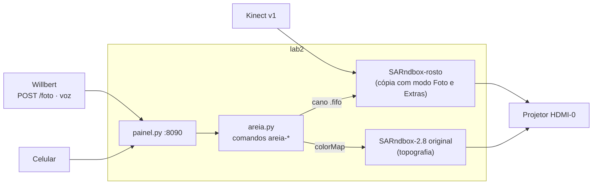

# Projetor-LAOB

> Caixa de areia de realidade aumentada do Laboratório LAOB: projeta relevo colorido, fotos que se deformam com a areia e brincadeiras (tesouro, fósseis, peixes, labirinto de água) a partir de um Kinect e um projetor.

   

## Sumário

- [Sobre](#sobre) · [Funcionalidades](#funcionalidades) · [Arquitetura](#arquitetura) · [Requisitos](#requisitos)
- [Instalação](#instalação) · [Uso](#uso) · [Configuração](#configuração) · [Testes](#testes)
- [Como funciona por dentro](#como-funciona-por-dentro) · [Estrutura do projeto](#estrutura-do-projeto)
- [Solução de problemas](#solução-de-problemas) · [Licença](#licença)

## Sobre

Roda no PC **lab2**, junto ao AR Sandbox (SARndbox 2.8, Kinect v1 e projetor). Ao ligar o PC
abre a **topografia** de sempre; por comando, atalho, painel do celular ou pelo
[Willbert-LAOB](https://github.com/VituColombo0/Willbert-LAOB), a caixa passa a mostrar uma
**foto** que se deforma conforme mexem na areia, ou uma das brincadeiras. Tudo roda localmente
(Python e modelos na própria pasta); só a instalação baixa coisas.

## Funcionalidades

- **Topografia:** o SARndbox original, sem mudanças, com 8 temas de cor e animação por tema (lava, neve, poeira, vento, mar, estrelas, chuva).
- **Foto:** a imagem é projetada sobre a areia, amplia onde está alta (efeito lente) e ganha a sombra do relevo; rosto sai recortado, sem fundo.
- **Esculpir:** o rosto vira relevo-alvo; o projetor pinta onde falta areia (vermelho) e onde sobra (azul).
- **Caça ao tesouro** e **fósseis de dinossauro** (T-Rex, Triceratops, Pterodáctilo, pegada): cave para achar.
- **Peixes e carrinhos:** peixes em cardume nos lagos, carrinhos seguindo os vales.
- **Labirinto de água:** leve a água da nascente até o alvo, com placar.
- **Uma brincadeira por vez:** começar uma encerra as outras; o tema de cor fica.
- **Painel do celular** (:8090), atalhos de dois cliques e `COMO USAR.txt` em cada pasta da Área de Trabalho.
- **Vigia:** reabre a topografia sozinho se ela fechar.

## Arquitetura



## Requisitos

- PC Ubuntu com o **SARndbox 2.8 compilado e calibrado** em `~/SARndbox-2.8`.
- Kinect v1 e projetor (tela cheia no HDMI-0).
- Placa NVIDIA com driver (no lab2: GTX 750 Ti, driver 535, kernel fixado com `kernel-com-driver.sh` do Willbert).
- Não precisa de sudo; o `instalar.sh` cria o Python próprio e baixa os modelos (YuNet e U²-Net, 176 MB).

## Instalação

1. Clone o repositório:

   ```bash
   git clone https://github.com/VituColombo0/Projetor-LAOB.git
   ```

2. Rode o instalador (pode rodar de novo para atualizar):

   ```bash
   cd Projetor-LAOB && bash instalar.sh
   ```

O `instalar.sh` copia o SARndbox para `~/SARndbox-rosto`, aplica os patches e compila, cria o venv,
baixa os modelos, instala os comandos em `~/.local/bin`, cria as pastas, ajudas e atalhos na Área
de Trabalho, troca o autostart para abrir a topografia e liga o painel e o vigia.
`bash instalar.sh --compilar /tmp/teste` só testa a compilação.

> [!WARNING]
> Antes de reinstalar no lab2, compare o lab2 com o repositório: mudanças feitas direto na
> máquina se perdem com o `instalar.sh`.

## Uso

Coloque as imagens na pasta **"2 - Fotos na areia"** da Área de Trabalho e use no terminal:

| Comando | O que faz |
| :--- | :--- |
| `areia-foto` | Lista as imagens e pergunta o número (Enter = a última) |
| `areia-foto 3` / `areia-foto gato` | Escolhe pelo número ou parte do nome |
| `areia-foto ~/Downloads/x.jpg` | Usa qualquer arquivo (é copiado para a pasta) |
| `areia-foto girar` / `espelhar` / `esculpir` | Gira 90°, espelha ou entra no modo esculpir |
| `areia-foto camera` | Foto pela câmera do laboratório (via Willbert) |
| `areia-foto lista` / `pasta` | Lista as imagens / abre a pasta |
| `areia-topografia` | Volta ao relevo |
| `areia-tema vulcao` | Tema: `classico`, `vulcao`, `inverno`, `marte`, `deserto`, `oceano`, `arco-iris`, `mapa` |
| `areia-tesouro [facil\|normal\|dificil\|achou\|parar]` | Caça ao tesouro |
| `areia-fossil trex [facil\|dificil]` | Fóssil: `trex`, `triceratops`, `pterodactilo`, `pegada` (também `achou`, `parar`) |
| `areia-animais todos [n]` | `peixes`, `carros` ou `todos` (também `parar`) |
| `areia-labirinto [facil\|normal\|dificil\|nova\|placar\|parar]` | Labirinto de água |
| `areia-vigia pausa` / `liga` | Pausa ou religa o vigia da topografia |

**Área de Trabalho do lab2:** pastas "1 - Topografia (ligar e consertar)", "2 - Fotos na areia",
"3 - Cores do relevo", "4 - Caça ao tesouro", "5 - Peixes e carrinhos", "7 - Fósseis de
dinossauro" e "8 - Labirinto de água" (a "6 - Willbert" vem do Willbert-LAOB). Cada uma tem
`COMO USAR.txt` e atalhos de dois cliques; os que pedem escolha abrem uma janela (`gui-*.sh`) e
todos passam por `gui-rodar.sh`, que avisa por notificação ou mostra o erro.

**Painel do celular:** `http://<IP-DO-LAB2>:8090` — selfie, foto salva ou câmera do laboratório,
modo, cores, brincadeiras e girar. O endereço aparece no canto do papel de parede do lab2
(`atualizar_papel_parede.py`, a cada minuto) e no atalho "Abrir painel da caixa de areia".

## Configuração

| Onde | O quê |
| :--- | :--- |
| `areia/temas/*.cpt` | Temas: altura em cm → cor RGB (abaixo de 0 é água); o ativo é o link `temas/atual.cpt` |
| `sarndbox/projetor.cfg` | Janela em tela cheia no projetor (HDMI-0) |
| `PARAR_BRINCADEIRAS` em `areia/areia.py` | Quais brincadeiras se encerram entre si |
| `/root/etc/SARndbox-2.8` | Calibração real do Kinect e do projetor |

Opções da foto: `--sem-fundo` recorta a pessoa mesmo sem rosto; `--com-fundo` nunca recorta. No
painel, "mistura" traz o relevo de volta e deformação 0 + sombra 0 projeta a foto sem efeito
(também por `POST /ajuste`).

## Testes

Testes automáticos, com projetor falso (imagem, área iluminada, relevo, pasta, cache, comandos,
painel e sintaxe/shellcheck dos scripts):

```bash
bash testes/rodar.sh
```

No lab2, depois do `instalar.sh` (~1 min; compila, confere a instalação, o painel e o projetor de
verdade, terminando na topografia):

```bash
bash testes/integracao.sh
```

## Como funciona por dentro

**Modo Foto** (`sarndbox/FaceImage.*`, `patch_surface.py`, `patch_sandbox.py`): a imagem vira
textura com a matriz câmera → imagem; o shader mostra só a imagem, com lente e sombra. Comandos
pelo cano `-cp`: `rosto`, `rostoAjuste`, `esculpir`, `relevo`. A foto ocupa só a área iluminada
(a calibração marca uma caixa maior que a projeção; hoje ~59 × 42 cm). Rosto detectado com YuNet;
recorte com U²-Net de pessoas (~3 s); a preparação (~5 s) fica em `fotos/cache/` (40 últimas) e
trocar para uma já usada leva ~1 s.

**Temas:** a topografia abre com `-uhm temas/atual.cpt -cp topografia.fifo`; `areia-tema` troca na
hora pelo `colorMap` do SARndbox (~0,1 s). Pontos ajustados aos morros de ~8–10 cm do lab2.

**Extras** (`sarndbox/Extras.*`): mapa de alturas de 1,5 cm por célula, 2× por segundo, simulação
na CPU e desenho no shader. Comandos: `tesouro [cm]`, `tesouroFim`, `animais peixes|carros|todos|nada [n]`,
`labirinto [nível]`, `labirintoNovo`, `labirintoFim`, `labirintoTeste`.

- **Tesouro:** sorteado onde há areia acima da média; aparece ao cavar; brilha dourado a menos de 2,5 cm; "Tesouro encontrado!" vai para o `sandbox.log`. Achado, reaparece em outro lugar após 20 s.
- **Fósseis:** mesmo mecanismo (`tipoTesouro` 2–5), raio maior, quadrícula de escavação e esqueleto em marfim; outro aparece em 30 s.
- **Peixes:** água = 1,5 cm abaixo da mediana; cardume com separação de ~5,5 cm, curvas suaves (até 2,8 rad/s); preso numa poça por 4 s, reaparece num lago de verdade.
- **Carrinhos:** seguem a curva de nível dos vales, evitam rampas e lagos, freiam só para o de número menor; travado 3 s, dá meia-volta.
- **Labirinto:** a nascente (disco de 2 cm) usa a água do próprio SARndbox (`addWater`); 2× por segundo mede a profundidade no alvo (`glGetTexImage`); com 0,25 cm escreve "Labirinto: a água chegou!", e após 20 s começa rodada nova.
- **Fluidez:** grade de água em 320×240 (`-wts 320 240`; 640×480 não dava conta na GTX 750 Ti). O log mostra `Desempenho: N quadros/s` a cada 30 s.

**Willbert:** o gesto das duas mãos manda a foto já recortada para `POST /foto` (só aceita a
própria máquina). Fotos `willbert-*` ficam na subpasta "Fotos do Willbert". O painel responde à
própria máquina, à rede local e à Tailscale; o resto recebe 403.

**Comandos internos** (`areia/sandbox.sh`):

```bash
./sandbox.sh rosto
./sandbox.sh cmd "relevo"
./sandbox.sh original
```

## Estrutura do projeto

```text
Projetor-LAOB/
├── instalar.sh          # instala/atualiza tudo no PC
├── requirements.txt     # Python do venv (OpenCV, NumPy, Flask, waitress)
├── sarndbox/            # modo Foto e Extras: FaceImage, Extras, patches, projetor.cfg
├── areia/               # areia.py, comandos areia-*, painel.py, rosto.py, temas/, gui-*.sh
├── area-de-trabalho/    # pastas numeradas com COMO USAR.txt e atalhos .desktop
├── sistema/             # serviços e timers de usuário (painel, vigia, papel de parede)
└── testes/              # rodar.sh (automático) e integracao.sh (no lab2)
```

No PC, tudo fica em `~/SARndbox-rosto` (cópia do SARndbox + estes arquivos, `venv/`, `modelos/`).

## Solução de problemas

| Sintoma | Causa provável | Correção |
| :--- | :--- | :--- |
| A areia não abre ao ligar | Kinect demorou no USB | O autostart espera até 30 s e tenta 3×; veja `~/SARndbox-rosto/inicio.log` ou use o atalho "Abrir a areia" |
| Topografia fechou sozinha | Programa caiu | O `areia-vigia` reabre em até 2 min |
| Areia a 1 quadro/s, projetor sumiu | Kernel novo sem o driver NVIDIA | Rode `kernel-com-driver.sh` (Willbert-LAOB) e reinicie |
| Foto aparece de lado | Orientação de quem olha a caixa | `areia-foto girar` |
| "Ran out of time" no log | Grade de água grande demais | Mantenha `-wts 320 240` |

Na Área de Trabalho também há `SE A AREIA NÃO ABRIR.txt`.

## Equipe

Desenvolvido no **Laboratório LAOB**.

- Victor Colombo
- Prof. Mario Gazziro

## Licença

O SARndbox é de Oliver Kreylos (UC Davis), sob GPL-2.0; os patches e o modo Foto deste
repositório seguem a mesma licença. Os modelos baixados têm licenças próprias: YuNet (OpenCV Zoo,
MIT) e U²-Net de pessoas (rembg / U²-Net, Apache-2.0).
