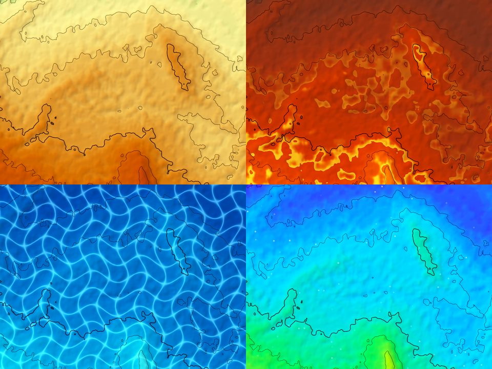
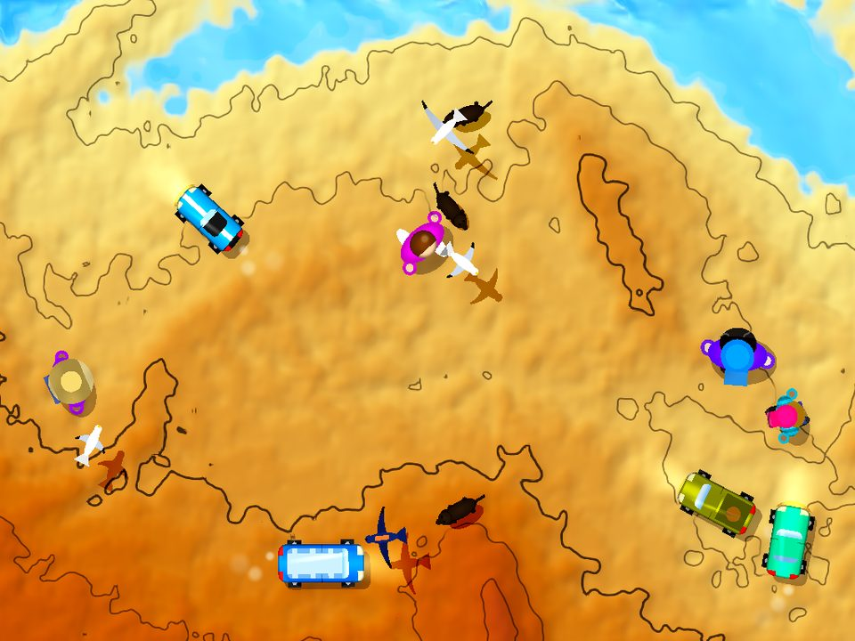
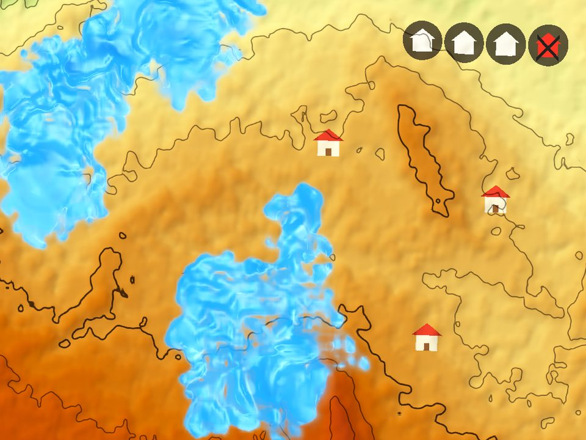
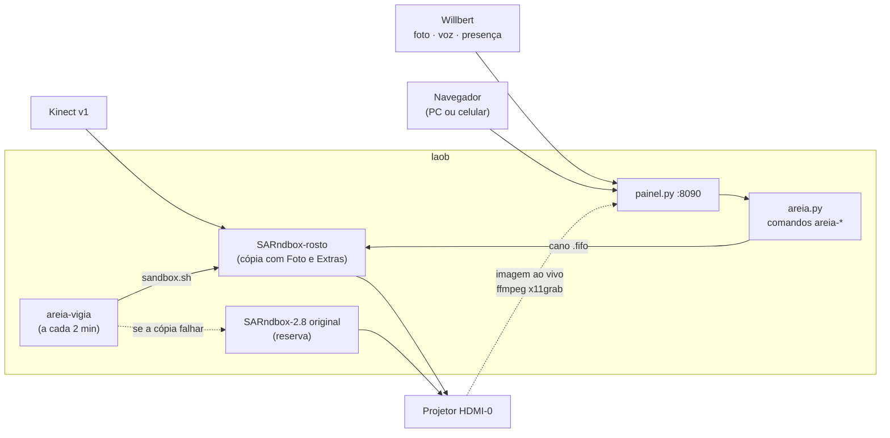

# Projetor-LAOB

> Caixa de areia de realidade aumentada do Laboratório LAOB: um Kinect mede a areia e o projetor pinta por cima relevo colorido, água, bichos, jogos e fotos, tudo controlado por um painel no navegador.

   



## Sumário

- [Sobre](#sobre) · [Funcionalidades](#funcionalidades) · [Arquitetura](#arquitetura) · [Requisitos](#requisitos)
- [Instalação](#instalação) · [Uso](#uso) · [Configuração](#configuração) · [Testes](#testes)
- [Estrutura do projeto](#estrutura-do-projeto) · [Solução de problemas](#solução-de-problemas)
  (com [manutenção](#manutenção) e [recuperação](#recuperação)) · [Roadmap](#roadmap) · [Equipe](#equipe) · [Licença](#licença)

## Sobre

O AR Sandbox (SARndbox 2.8, da UC Davis) colore a areia pela altura. Este repositório monta, no PC
**laob** do laboratório, uma cópia do SARndbox com brincadeiras por cima: bichos que vivem na água
simulada, jogos de água, escavações, o laboratório desenhado na areia e fotos que se deformam com o
relevo. O SARndbox original fica intacto como reserva. Tudo roda localmente, a 30 quadros por segundo, e
o jeito normal de usar é o **painel** no navegador, pelo computador ou pelo celular.

Para quem só vai usar: [manual do laboratório](docs/MANUAL.md) e [roteiro de apresentação](docs/APRESENTACAO.md).

## Funcionalidades

- **Topografia** em 7 temas de cor (Clássico, Vulcão, Inverno, Marte, Deserto, Oceano, Arco-íris), com
  animação por tema e curvas de nível a cada 0,75 cm, como no SARndbox original.
- **Água única:** chuva pela mão aberta ou pelo painel, lago dos bichos e azul do mapa são a mesma água
  simulada, com correnteza.
- **Vida na areia:** até 32 de cada espécie, na água (peixes, tubarão, tartaruga, água-viva, polvo,
  arraia, pato, barco), em terra (carros, pessoas, cachorros) e no ar (pássaros). Comida pelo painel ou
  apontando o indicador: tigela na terra, ração na água.
- **Jogos de água:** Corrida de rios, Salve a vila, Rota com paradas e Vulcão em erupção, em três níveis.
- **Labirinto de água**, **Copie o relevo**, **caça ao tesouro** e **fósseis de dinossauro**.
- **Mundo LAOB:** a planta do laboratório (sala principal, forense, miniauditório) com um boneco por
  membro; quem o [Willbert-LAOB](https://github.com/VituColombo0/Willbert-LAOB) vê no laboratório fica lá dentro.
- **Foto na areia:** a imagem se deforma com o relevo (lente e sombra); **Esculpir** transforma o rosto em
  relevo-alvo.
- **Sons automáticos** por tema e brincadeira, nas caixas e no HDMI do projetor.
- **Painel** com abas (Jogos, Vida, Chuva, LAOB, Fotos, Projetor), imagem do projetor ao vivo e linha de saúde.
- **Vigia:** reabre a areia se ela fechar ou travar e cai para uma topografia de reserva se a versão
  completa não abrir.

<p>
  
  
</p>

O detalhe de cada brincadeira e das peças internas está em [docs/COMO-FUNCIONA.md](docs/COMO-FUNCIONA.md).

## Arquitetura



O `instalar.sh` copia o SARndbox para `~/SARndbox-rosto`, aplica os patches (`sarndbox/patch_*.py`) e
compila. Os comandos `areia-*` e o painel falam com a areia por um cano (`.fifo`); o `sandbox.sh` abre e
fecha o programa, uma troca por vez. O vigia, um timer do systemd do usuário, confere a areia a cada 2 min.

## Requisitos

**Hardware**

- Kinect v1 sobre a caixa de areia e projetor em 1024×768 no HDMI-0, à direita do monitor.
- Placa NVIDIA com driver (no laob: GTX 750 Ti, driver 535, kernel fixado no 6.5 pelo `kernel-com-driver.sh` do Willbert-LAOB).

**Software**

- Ubuntu 22.04 com o **SARndbox 2.8 compilado** em `~/SARndbox-2.8`, Vrui-8.0 e Kinect-3.10 em `/usr/local`,
  e a calibração em `/root/etc/SARndbox-2.8` (ou na pasta de `SARNDBOX_CALIB`).
- Obrigatórios: `build-essential python3-venv wget`. Opcionais: `ffmpeg` (imagem ao vivo),
  `pulseaudio-utils` (som), `x11-utils x11-xserver-utils` e `curl` (testes). O instalador confere tudo e
  mostra a linha de `apt` pronta.
- Sem sudo: o instalador cria o Python próprio e baixa os modelos (YuNet e U²-Net, 176 MB).

## Instalação

1. Clone o repositório:

   ```bash
   git clone https://github.com/VituColombo0/Projetor-LAOB.git
   ```

2. Confira a máquina (só lê; uma linha OK/AVISO/FALTA por item, sai com erro se houver FALTA):

   ```bash
   cd Projetor-LAOB && bash instalar.sh --verificar
   ```

3. Instale (pode rodar de novo para atualizar, sem duplicar nada):

   ```bash
   bash instalar.sh
   ```

O instalador compila a cópia em `~/SARndbox-rosto`, cria o venv, baixa os modelos, põe os comandos em
`~/.local/bin`, deixa na Área de Trabalho só o atalho do painel e o `LEIA-ME - caixa de areia.txt`, faz a
topografia abrir ao ligar o PC e liga o painel e o vigia. Se o programa da areia mudou, ele **reabre a
areia** sozinho (a aberta continuaria com o programa antigo). Uma recalibração mais nova na cópia não é
sobrescrita. `bash instalar.sh --compilar /tmp/teste` só testa a compilação.

> [!WARNING]
> Antes de reinstalar no laob, compare o laob com o repositório: mudanças feitas direto na máquina se
> perdem com o `instalar.sh`.

## Uso

**Pelo painel** (o jeito normal): no laob, o atalho **Abrir painel da caixa de areia**
(`http://localhost:8090`); de outro aparelho na rede do laboratório, `http://<IP-DO-LAOB>:8090`. O endereço
aparece no canto inferior esquerdo do papel de parede do laob, e `#jogos`, `#vida`, `#chuva`, `#laob`,
`#fotos` ou `#projetor` no fim abre direto na aba. O passo a passo para leigos está no
[manual](docs/MANUAL.md).

**Linha de saúde** (aba Projetor, também em `GET /saude`): quadros/s, água em % do tempo real, p99 do
quadro, temperatura e uso da GPU, disco livre, tempo ligado, estado do vigia, topografia de reserva e o
último aviso do `inicio.log` nas últimas 48 h. O que estiver fora do normal fica em vermelho. Normal:
30 qps, água 100%, p99 perto de 34 ms.

**Pelo terminal** do laob:

| Comando | O que faz |
| :--- | :--- |
| `areia-topografia` | Volta ao relevo (encerra a brincadeira) |
| `areia-tema vulcao` | Tema: `classico`, `vulcao`, `inverno`, `marte`, `deserto`, `oceano`, `arco-iris` |
| `areia-animais mar peixe=8 tubarao=1 carro=3` | Vida na areia: `peixe`, `tubarao`, `tartaruga`, `aguaviva`, `polvo`, `arraia`, `pato`, `barco`, `carro`, `pessoa`, `cachorro`, `passaro` (`parar` tira) |
| `areia-animais mundo` | Mundo LAOB; `areia-animais vista principal\|forense\|mini\|tudo\|NOME` |
| `areia-jogo <jogo> [facil\|normal\|dificil]` | `corrida`, `vila`, `rota`, `vulcao` (também `placar`, `nova`, `parar`) |
| `areia-jogo copia [forma] [nível]` | Copie o relevo: `montanha`, `duas`, `vulcao`, `cratera`, `ilha`, `serra` |
| `areia-labirinto [facil\|normal\|dificil\|nova\|placar\|parar]` | Labirinto de água |
| `areia-tesouro [facil\|normal\|dificil\|achou\|parar]` | Caça ao tesouro |
| `areia-fossil trex [facil\|dificil]` | Fóssil: `trex`, `triceratops`, `pterodactilo`, `pegada` |
| `areia-foto [número\|nome\|arquivo]` | Foto na areia; também `girar`, `espelhar`, `esculpir`, `camera`, `lista`, `pasta` |
| `areia-vigia estado` | `vigiando`, `pausado até HH:MM` ou `pausado sempre` (e a reserva, se houver) |
| `areia-vigia pausa [30m\|3h\|sempre]` / `liga` | Pausa o vigia (2 h por padrão; volta sozinho) ou religa |

Uma brincadeira por vez: começar outra encerra a anterior; o tema fica. As fotos ficam em
`Imagens/Fotos na areia`. Comandos de teste pelo cano (`~/SARndbox-rosto/sandbox.sh cmd "..."`):
[docs/COMO-FUNCIONA.md](docs/COMO-FUNCIONA.md#extras-e-comandos-do-cano).

## Configuração

| Onde | O quê |
| :--- | :--- |
| `areia/temas/*.cpt` | Temas: altura em cm → cor RGB (abaixo de 0 é água); o ativo é o link `temas/atual.cpt` |
| `sarndbox/projetor.cfg` | Janela em tela cheia no projetor (HDMI-0) |
| `~/SARndbox-rosto/luz.txt` | Brilho da imagem (Normal, Forte ou Máximo, gravado pelo painel) |
| `~/SARndbox-rosto/estado_som.json` | Mudo e volume (no cabeçalho do painel). Saída `combinado`: HDMI do projetor + caixas |
| `~/SARndbox-rosto/membros/Nome.jpg` | Fotos dos membros do Mundo LAOB (até 8; fora do repositório) |
| `/root/etc/SARndbox-2.8` | Calibração do Kinect e do projetor (`SARNDBOX_CALIB` troca a pasta; `testes/dados/` guarda a do laob) |
| `PARAR_BRINCADEIRAS` em `areia/areia.py` | Quais brincadeiras se encerram entre si |

## Testes

Automáticos, com projetor falso (imagem, comandos, painel, scripts, instalador, dedo apontado, rotas do
Mundo e, onde há GPU com EGL, as variantes do shader pixel a pixel). Passou = última linha `TUDO OK`:

```bash
bash testes/rodar.sh
```

No laob, depois do `instalar.sh` (~2 min; confere a instalação, o painel e o projetor de verdade e termina na
topografia):

```bash
bash testes/integracao.sh
```

Medidas e prints no laob (usam o projetor por alguns minutos e terminam na topografia):

```bash
bash testes/medir.sh
```

```bash
bash testes/prancha.sh
```

O `medir.sh` grava em `~/medidas/<data>/medidas.tsv` troca, qps, p50/p95/p99 do quadro, água, GPU, CPU e
memória de cada tema e brincadeira; o `prancha.sh` tira um print de cada combinação, e
`python3 testes/monta_prancha.py <pasta> prancha.jpg` junta numa grade.

## Estrutura do projeto

```text
Projetor-LAOB/
├── instalar.sh          # instala/atualiza tudo no PC (--verificar só confere)
├── requirements.txt     # Python do venv (OpenCV, NumPy, Flask, waitress)
├── sarndbox/            # Foto, Extras, Jogos, Mundo, Gesto, Perfil e os patches do SARndbox
├── areia/               # areia.py, comandos areia-*, sandbox.sh, areia-vigia, painel.py, som.py, temas/, sons/
├── area-de-trabalho/    # atalho do painel e LEIA-ME da Área de Trabalho do laob
├── sistema/             # serviços e timers de usuário (painel, vigia, papel de parede)
├── deploy/laob/         # otimizar-projetor.sh (ajustes da máquina)
├── docs/                # MANUAL, APRESENTACAO, COMO-FUNCIONA, RECUPERACAO e img/
└── testes/              # rodar.sh, integracao.sh, medir.sh, prancha.sh e testes em C++
```

No laob, tudo fica em `~/SARndbox-rosto` (cópia do SARndbox, estes arquivos, `venv/` e `modelos/`).

## Solução de problemas

| Sintoma | Causa provável | Correção |
| :--- | :--- | :--- |
| A areia não abre ao ligar | Kinect demorou no USB | O autostart tenta 3× e o vigia abre em até 2 min; veja `~/SARndbox-rosto/inicio.log` ou toque em "Reabrir a areia" |
| Imagem parada, botões sem resposta | Areia ou GNOME travados | O vigia reabre em até 2 min; na hora, "Reabrir a areia" (aba Projetor) |
| A brincadeira sumiu e voltou o relevo | O vigia reabriu a areia (fechou ou parou) | Normal; o motivo fica no `inicio.log` e em "Último aviso" |
| Painel mostra **Areia: reserva** | A versão com Foto não abriu; entrou o SARndbox original (só topografia) | Veja `~/SARndbox-rosto/sandbox.falhou.log`; "Reabrir a areia", ou espere o vigia (a cada 10 min, até 3×/h) |
| Saúde mostra **vigia pausado** | Pausa de teste ou de propósito | "Reabrir a areia" ou `areia-vigia liga` (a pausa comum vence em 2 h; `sempre` não) |
| Integração acusa "vigia da areia agendado" | Vigia pausado num teste | `areia-vigia liga` |
| Sem som | Mudo de propósito no laob (volume 97) | Mudo e volume no cabeçalho do painel; a saída `combinado` aparece em `pactl list short sinks` e é refeita sozinha |
| Areia a 1 qps, projetor sumiu após reiniciar | Kernel novo sem o driver NVIDIA (o 6.8 das atualizações não tem) | `kernel-com-driver.sh` do Willbert-LAOB (sudo do Victor) e reiniciar no 6.5 |
| Areia cai para 1 qps depois de um tempo parada | O GNOME apagou a tela (protetor) | A areia segura o protetor com `gnome-session-inhibit`; `bash deploy/laob/otimizar-projetor.sh` deixa a tela sem apagar |
| "outra troca da areia em andamento" | Duas trocas ao mesmo tempo | Espere alguns segundos e tente de novo |
| `instalar.sh` parou na etapa X | Erro mostrado com a linha e o comando | Corrija e rode de novo (nada instalado é apagado) |
| `glPrintError: Invalid operation` ao abrir a foto | Aviso único do OpenGL na troca de shader | Inofensivo |

### Manutenção

- **Registros** em `~/SARndbox-rosto`: `sandbox.log` (a cada 30 s as linhas `Desempenho:` e `Perfil:`; a vez
  anterior em `sandbox.log.1`; o vigia encolhe acima de 5 MB sem fechar a areia), `inicio.log` (aberturas
  e o que o vigia fez) e `sandbox.falhou.log` (por que a versão completa não abriu). O painel escreve no
  journal: `journalctl --user -u sandbox-painel`.
- **Ajustes da máquina:** `deploy/laob/otimizar-projetor.sh`, reversível. Sem sudo, a tela do GNOME não apaga;
  com sudo (o Victor digita), journal limitado a 500 MB e a atualização automática fora do boot. Antes, veja
  o que faria:

  ```bash
  bash deploy/laob/otimizar-projetor.sh --simular
  ```

  `--desfazer` volta ao que estava.
- **Desempenho:** `testes/medir.sh` e `testes/prancha.sh` (veja [Testes](#testes)) depois de mudar o visual
  ou a simulação. Meta: 30 qps, água 100%, p99 sem passar de 50 ms, troca de 0,1 a 0,3 s.
- **Membro novo:** foto `Nome.jpg` em `~/SARndbox-rosto/membros/`; os rostos são refeitos ao abrir o Mundo
  LAOB (`membros.py`).

### Recuperação

Se o disco do laob morrer, ou para montar tudo numa máquina nova: [docs/RECUPERACAO.md](docs/RECUPERACAO.md),
com o backup que precisa estar guardado fora do laob (fontes do Vrui/Kinect/SARndbox, calibração e fotos).

## Roadmap

- Planta do laboratório: confirmar onde fica a caixa de areia na sala e o lugar de cada um (hoje estimados).
- Willbert numa máquina nova, com várias câmeras: ligar o painel a ele pela rede (presença, foto, ligar/desligar).

## Equipe

Desenvolvido no **Laboratório LAOB**.

- Victor Colombo
- Prof. Mario Gazziro

## Licença

O SARndbox é de Oliver Kreylos (UC Davis), sob GPL-2.0; os patches e o código deste repositório seguem a
mesma licença. Os modelos baixados têm licenças próprias: YuNet (OpenCV Zoo, MIT) e U²-Net de pessoas
(rembg / U²-Net, Apache-2.0). Histórico de versões no [CHANGELOG](CHANGELOG.md).
